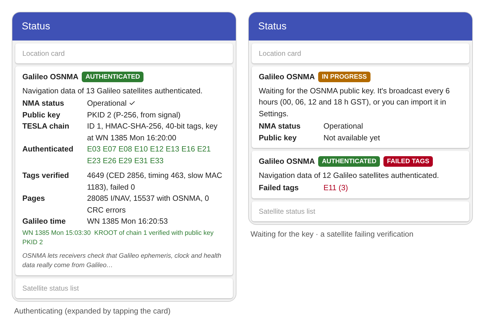

# Galileo OSNMA

GPSTest can verify Galileo Open Service Navigation Message Authentication
([OSNMA](https://www.gsc-europa.eu/galileo/services/galileo-open-service-navigation-message-authentication-osnma)).
OSNMA lets a receiver check that the ephemeris, clock and health data broadcast by Galileo
satellites really comes from Galileo and hasn't been forged by a spoofer.

GPSTest does all the cryptography on the phone, from the Galileo E1-B I/NAV navigation messages
that Android delivers to apps. The result is shown on the **Status** screen.



*Mockup of the card. The numbers in the left screen come from a real receiver recording.*

## Requirements

- A device that provides Galileo navigation messages to apps (`GnssNavigationMessage` of type
  `TYPE_GAL_I`). Many don't. Check "Navigation Messages" under *What GNSS features does my
  device support?* in the [FAQ](FAQ.md). The OSNMA card only appears once such messages arrive.
- Galileo satellites in view, ideally with a clear sky. Authentication starts after a few
  minutes of continuous reception.
- A correct device clock (within 30 seconds). See [Limitations](#limitations).

## The Status card

| Field | Meaning |
| --- | --- |
| Status chip | **AUTHENTICATED** (green): navigation data is being verified. **IN PROGRESS** (amber): waiting for the public key, the TESLA root key or the first tags. **NO DATA** (gray): no OSNMA data yet. **DON'T USE**, **ALERT**, **TIME NOT VERIFIED** and **FAILED TAGS** (red): see below. |
| NMA status | Operational, Test or Don't use, as broadcast by Galileo. A ✓ means it was confirmed by a verified signature. |
| Public key | The ECDSA public key ID (PKID), its curve and where it came from: *from signal*, *Merkle tree file* or *imported*. |
| TESLA chain | Chain ID, MAC function, tag size and time of the latest verified TESLA key. |
| Authenticated | Satellites whose current ephemeris, clock and health data is authenticated. That means at least 40 bits of MAC tags were verified on the data the satellite is broadcasting right now. |
| Failed tags | Satellites with a tag that failed verification in the last 10 minutes, with the count. |

Tap the card for details: tag counts by type (CED, timing, slow MAC), page and CRC counters,
Galileo time and the latest events.

### Red states

- **FAILED TAGS**: a MAC tag didn't match the received navigation data. This can be caused by
  corrupted data or timing problems, but also by spoofing. Treat data from those satellites as
  untrusted.
- **TIME NOT VERIFIED**: the device clock differs from the Galileo time in the signal by more
  than 30 s. OSNMA can't detect replayed or delayed signals without an independent time source,
  so check the date and time settings.
- **DON'T USE**: Galileo has set the OSNMA status to "don't use". Nothing is authenticated
  until that changes.
- **ALERT**: an authenticated OSNMA Alert Message was received. All keys, including the built-in
  Merkle tree root, are no longer trusted. Import new key material from the GSC to resume.

## Keys

OSNMA needs the Galileo ECDSA public key to verify the TESLA root key. GPSTest gets it in one of
two ways:

1. **From the signal (default).** Galileo broadcasts the public key every 6 hours, at 00, 06, 12
   and 18 h Galileo time. GPSTest verifies it against the built-in Merkle tree root and stores
   it, so this is only needed once per key.
2. **Imported.** To start right away, download the files from the
   [European GNSS Service Centre](https://www.gsc-europa.eu/gsc-products/OSNMA/PKI) (free
   registration). Import one under **Settings > Galileo OSNMA > Import OSNMA public key or
   Merkle tree**. Supported files:
   - `OSNMA_MerkleTree_*.xml`: replaces the Merkle tree root. The public key it contains is
     verified against that root before use.
   - `OSNMA_PublicKey_*.xml`
   - `OSNMA_PublicKey_*.crt` or a PEM public key. The PKID is taken from the file name
     (`…PKID_2…`).

**Forget OSNMA keys** deletes the stored public keys and any imported Merkle tree.
**Authenticate Galileo navigation data** turns the feature off.

## What is verified

GPSTest follows the
[OSNMA SIS ICD v1.1](https://www.gsc-europa.eu/sites/default/files/sites/all/files/Galileo_OSNMA_SIS_ICD_v1.1.pdf)
and the OSNMA Receiver Guidelines:

- I/NAV page CRC (CRC-24Q)
- DSM-PKR: public keys against the Merkle tree root
- DSM-KROOT: ECDSA P-256/SHA-256 or P-521/SHA-512 signature of the TESLA root key
- TESLA key chain (SHA-256 or SHA3-256), MACSEQ and the MAC look-up table
- MAC tags (HMAC-SHA-256 or CMAC-AES) for ADKD 0 (ephemeris, clock and health), ADKD 4
  (timing parameters) and ADKD 12 (slow MAC)
- Chain renewal and revocation, public key renewal and revocation, alert messages

The engine is in `library/src/main/java/com/android/gpstest/library/osnma`. It's pure Kotlin
without Android or third-party dependencies, and is modelled on the
[galileo-osnma](https://github.com/daniestevez/galileo-osnma) Rust library. It produces the
same results as galileo-osnma, tag for tag, on all
[GSC OSNMA test vector](https://www.gsc-europa.eu/support-to-developers/osnma-test-vectors)
scenarios and on a real receiver recording. The unit tests in
`library/src/test/java/com/android/gpstest/library/osnma` run on a trimmed test vector:

```
./gradlew :library:testDebugUnitTest --tests "com.android.gpstest.library.osnma.*"
```

## Limitations

- **Only the navigation messages are authenticated.** GPSTest can't tell whether the device's
  own position fix used authenticated data. The chipset computes the fix independently.
- **Time comes from the signal.** Android doesn't provide the Galileo time of each page, so
  GPSTest reads it from the I/NAV words and the arrival times. It's compared with the device
  clock, which must be correct for authentication to be meaningful (see *TIME NOT VERIFIED*).
  Like any OSNMA receiver without a secure time source, it can't detect all replay or delay
  attacks.
- **Data must be complete.** A satellite is only authenticated once all the words covered by
  its tags have been received, so weak or intermittent signals can delay it.
- **Devices that skip the CRC bits.** If a device doesn't fill in the I/NAV CRC bits, GPSTest
  falls back to the device's own parity check and says so in the details.
